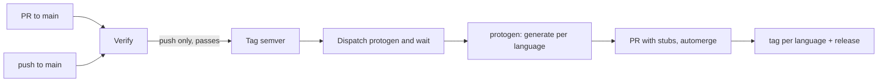

# protos

gRPC contracts (`.proto` only). Generated stubs for every language live in [`protogen`](https://github.com/huponx/protogen).

```
buf.yaml                 # lint + breaking rules (buf v2)
buf.gen.<lang>.yaml      # one generation template per language: go java scala rust
ping/v1/ping.proto
courier/v1/courier.proto
scripts/                 # verify.sh, generate.sh, lib.sh, install-scalapb.sh
```

Add a new API by adding `bill/v1/bill.proto` here. Do not create a new repo.

## Pipeline



| Workflow | Trigger | What it does |
|---|---|---|
| [`ci.yml`](.github/workflows/ci.yml) | PR and push to `main`, **Run workflow** | `verify` always; `release` and `notify` only on push / manual run |
| [`notify-protogen.yml`](.github/workflows/notify-protogen.yml) | called by `ci.yml`, **Run workflow** | dispatches protogen, waits for its result |
| [`automerge.yml`](.github/workflows/automerge.yml) | PR events | enables auto-merge when the PR has the `automerge` label |

First time here? Follow [Setup](#setup-one-time) for tokens, secrets and branch protection.

`main` is protected: every change, including the stubs that protogen commits, goes through a PR.

## Verify

[`scripts/verify.sh`](scripts/verify.sh) runs these rules in order. The first failure stops the run.

1. `buf format -d --exit-code`: consistent formatting. Fix with `buf format -w`.
2. `buf lint`: `STANDARD` rules from [`buf.yaml`](buf.yaml).
3. `buf build`: everything compiles.
4. `buf breaking --against <latest tag>`: `FILE` rules. Skipped when there is no tag yet and on a manual `major` release. See [Breaking changes](#breaking-changes).
5. Trial generate: every `buf.gen.<lang>.yaml` is generated into a temp dir, so plugin and template errors are caught on the PR, before protogen runs. Go is also generated and built with the layout of a future major (`go/v2/`) so that layout never rots. Compiling the stubs of every language happens in protogen.

```bash
bash scripts/verify.sh
# against a previous release:
BUF_BREAKING_AGAINST='.git#tag=v0.1.0' bash scripts/verify.sh
# without scala (needs protoc-gen-scala on PATH, see below):
VERIFY_SKIP_MISSING=1 bash scripts/verify.sh
```

`buf` is pinned by `BUF_VERSION` in [`ci.yml`](.github/workflows/ci.yml) (and in protogen's `generate.yml`); keep both equal and bump them in their own PR. `buf.yaml` / `buf.gen.*.yaml` use config `v2`, which needs buf 1.32 or newer.

Remote plugins on buf.build are rate limited when anonymous. If CI fails with `resource_exhausted`, add a `BUF_TOKEN` secret (a buf.build token).

## Breaking changes

`buf breaking` failing fails `verify`: the PR cannot merge, nothing is tagged, protogen is not notified.

Prefer a change that is not breaking: add a new field, mark the old one `deprecated`, `reserved` the number and name of a removed field, or add a `v2` package (`ping/v2`) next to `v1`. Deleting a `.proto` file **is** breaking (there is no exception for it).

When the break is intended:

1. Add the `breaking-change` label to the PR. `verify` then reports the breaking changes in the job summary and a warning, instead of failing. The label has no effect without a real breaking change.
2. After merge, `release` bumps the **minor** version (`v0.3.1` -> `v0.4.0`, `v1.4.2` -> `v1.5.0`), never major. From `v1.x` this does not follow semver strictly; it is a deliberate choice for this repo.
3. A major version is only created by hand: **Run workflow** with `bump = major`. That run skips the breaking check.

On a push to `main` the label is read from the merged PR of the commit. If it was added after merging, `verify` already failed; re-run after fixing or use a manual release.

## Versioning and releases

After a successful `verify` on `main`, [`ci.yml`](.github/workflows/ci.yml) creates the next semver tag and a GitHub Release (`gh release create`):

- first tag is `v0.1.0`; later pushes bump **patch**, acknowledged breaking changes bump **minor**
- no tag when the push does not touch `*.proto`, `buf.yaml`, `buf.gen.*.yaml` or `scripts/generate.sh` / `scripts/lib.sh`, or when `HEAD` is already tagged
- **Run workflow** lets you pick `patch`, `minor` or `major`
- PRs only verify

Creating the tag starts `notify` (in the same workflow run), which sends `repository_dispatch` to protogen with `proto_ref` and `proto_repo`, then waits for protogen's generate run. The run fails if any language failed.

Re-notify an existing tag: **Run workflow** on `notify-protogen` and set `proto_ref` (for example `v0.2.0`).

## Languages

| Language | Template | Output in protogen | Tag in protogen | Compile check |
|---|---|---|---|---|
| go | [`buf.gen.go.yaml`](buf.gen.go.yaml) | `go/` | `go/vX.Y.Z` | `go build ./...` |
| java | [`buf.gen.java.yaml`](buf.gen.java.yaml) | `java/src/main/java` | `java/vX.Y.Z` | `mvn compile` |
| scala | [`buf.gen.scala.yaml`](buf.gen.scala.yaml) | `scala/src/main/scala` | `scala/vX.Y.Z` | `sbt compile` |
| rust | [`buf.gen.rust.yaml`](buf.gen.rust.yaml) | `rust/src/gen` | `rust/vX.Y.Z` | `cargo check` |

Besides these, protogen creates the common tag and release `vX.Y.Z` once at least one language succeeded.

### Go

Module path `github.com/huponx/protogen/go`; import `github.com/huponx/protogen/go/ping/v1`:

```bash
go get github.com/huponx/protogen/go@v0.2.0   # resolves the tag go/v0.2.0
```

Go requires a `/vN` suffix from major 2 on. The workflow handles it from the major of the release (`go_layout` in [`scripts/lib.sh`](scripts/lib.sh)):

| Major | Directory | Module | Tag |
|---|---|---|---|
| 0, 1 | `go/` | `github.com/huponx/protogen/go` | `go/v1.2.0` |
| 2+ | `go/v2/` | `github.com/huponx/protogen/go/v2` | `go/v2/v2.0.0` |

`buf.gen.go.yaml` uses managed mode, so `go_package` is derived from the module and stubs import each other with the right path. Older major directories are left untouched (maintaining `v1` after `v2` is out of scope).

### Scala

ScalaPB has no remote plugin on buf.build. `protoc-gen-scala` must be on `PATH`; [`scripts/install-scalapb.sh`](scripts/install-scalapb.sh) downloads the self-contained executable from Maven Central (needs `curl` and a JDK). CI does this itself.

### Add a language

1. Add `buf.gen.<lang>.yaml` here (`out:` is relative to the protogen root) and the language to `ALL_LANGS`, `stub_dir` and `lang_root` in [`scripts/lib.sh`](scripts/lib.sh).
2. In protogen: add `<lang>/` with its build file, a case in the shared `lang-setup` and `lang-compile` actions of `huponx/actions`, and the name in `meta` of `generate.yml` and the matrix of `check.yml`.

Nothing else changes: `generate`, `publish`, tagging and the summary are generic.

## Result per language

Each language is generated and compiled by its own matrix job, so one failing language never blocks the others. protogen opens one PR with the stubs of the languages that passed, waits for it to merge, then tags **only those languages**. A failed language gets no tag and its directory is unchanged.

Where to look:

- the protogen run summary: one row per language, failed ones first and marked `FAILED, no tag`; each failure also has an error annotation
- this repo's `notify` job: summary plus output `failed_langs`
- the GitHub Release `vX.Y.Z` in protogen: a table of pass/fail and tags

Re-run only what failed: **Run workflow** on protogen's `Generate stubs` with `proto_ref` and `langs` (for example `java rust`). The existing release is updated, not recreated. A language tag that already exists with identical stubs is skipped; with different stubs it is reported as a failure and never moved.

## Setup (one time)

Do this once for both repos. Replace `huponx` if the owner differs. Needs `gh` logged in as a repo admin.

```bash
OWNER=huponx
PROTOS=$OWNER/protos
PROTOGEN=$OWNER/protogen
```

**Order matters:** merge the workflow files to `main` first (step 0), then turn on branch protection (step 5). Once protection is on you can no longer push to `main`.

### 0. Merge the workflows

Push or merge these changes to `main` of both repos while `main` is still unprotected.

### 1. Labels

```bash
for repo in $PROTOS $PROTOGEN; do
  gh label create automerge --repo $repo --color 0E8A16 \
    --description "Merge automatically when checks pass" --force
done
gh label create breaking-change --repo $PROTOS --color D93F0B \
  --description "Intentional breaking change; release bumps minor" --force
```

### 2. Repository settings

Squash merge, auto-merge and automatic deletion of merged branches:

```bash
for repo in $PROTOS $PROTOGEN; do
  gh api -X PATCH repos/$repo \
    -F allow_auto_merge=true -F delete_branch_on_merge=true \
    -F allow_squash_merge=true -F allow_merge_commit=false -F allow_rebase_merge=false
done
```

Also check **Settings > Actions > General > Workflow permissions** allows workflows to run (default is fine; the workflows declare their own `permissions`).

### 3. Token

One fine-grained personal access token can serve every secret below (a GitHub App token also works).

1. GitHub > **Settings > Developer settings > Personal access tokens > Fine-grained tokens > Generate new token**.
2. Name `protos-protogen-bot`, set an expiration (and a calendar reminder to rotate it).
3. **Resource owner**: `huponx`. **Repository access**: *Only select repositories* > `protos` and `protogen`.
4. **Repository permissions**:

   | Permission | Level | Why |
   |---|---|---|
   | Contents | Read and write | `repository_dispatch`, push branches and tags, create releases |
   | Pull requests | Read and write | open PRs, enable auto-merge |
   | Actions | Read and write | read and watch protogen runs |
   | Metadata | Read | selected automatically |

5. The token owner must be an **admin** of both repos: tag and branch rules below let that role bypass them, which is how the bot creates tags.

Why not `GITHUB_TOKEN`: pushes, PRs and merges made with it do not trigger other workflows. The stubs PR would never get its `check`, and a merge to `protos` would never start `ci.yml` on `main`.

### 4. Secrets and variables

```bash
# protos
gh secret set PROTOGEN_DISPATCH_TOKEN --repo $PROTOS    # paste the token
gh secret set BOT_TOKEN --repo $PROTOS                  # same token
gh variable set PROTOGEN_REPO --repo $PROTOS --body "$PROTOGEN"   # optional, this is the default

# protogen
gh secret set BOT_TOKEN --repo $PROTOGEN                # same token
gh variable set PROTO_REPO --repo $PROTOGEN --body "$PROTOS"      # optional, this is the default
```

| Repo | Name | Kind | Required | Purpose |
|---|---|---|---|---|
| protos | `PROTOGEN_DISPATCH_TOKEN` | secret | yes | dispatch protogen, read its runs and artifacts |
| protos | `BOT_TOKEN` | secret | yes | `automerge.yml`; create release tags past the tag rule |
| protos | `PROTOGEN_REPO` | variable | no | default `huponx/protogen` |
| protos | `BUF_TOKEN` | secret | no | avoids buf.build rate limits (see [Verify](#verify)) |
| protogen | `BOT_TOKEN` | secret | yes | open stubs PRs, enable auto-merge, push tags |
| protogen | `PROTO_REPO` | variable | no | default proto repo for manual runs |
| protogen | `PROTO_READ_TOKEN` | secret | only if `protos` is private | read access to `protos` |
| protogen | `BUF_TOKEN` | secret | no | avoids buf.build rate limits |

`BUF_TOKEN` comes from buf.build: sign in (a free account is enough) at https://buf.build, open **Settings > Tokens** (https://buf.build/settings/user), click **Create Token**, name it (for example `ci-protos`), set an expiry, and copy it right away (it is shown once). Then store it in both repos; `gh` prompts for the value, so paste the token when asked:

```bash
gh secret set BUF_TOKEN --repo huponx/protos
gh secret set BUF_TOKEN --repo huponx/protogen
```

It is optional: without it CI works until buf.build rate limits anonymous calls (`resource_exhausted`).

### 5. Branch protection for `main`

Create a ruleset in each repo. Save as `main-ruleset.json`, changing the status check name per repo (`verify` for `protos`, `check` for `protogen`):

```json
{
  "name": "protect main",
  "target": "branch",
  "enforcement": "active",
  "conditions": { "ref_name": { "include": ["~DEFAULT_BRANCH"], "exclude": [] } },
  "rules": [
    { "type": "deletion" },
    { "type": "non_fast_forward" },
    {
      "type": "pull_request",
      "parameters": {
        "required_approving_review_count": 0,
        "dismiss_stale_reviews_on_push": false,
        "require_code_owner_review": false,
        "require_last_push_approval": false,
        "required_review_thread_resolution": false
      }
    },
    {
      "type": "required_status_checks",
      "parameters": {
        "strict_required_status_checks_policy": true,
        "required_status_checks": [ { "context": "verify" } ]
      }
    }
  ],
  "bypass_actors": []
}
```

```bash
gh api repos/$PROTOS/rulesets --method POST --input main-ruleset.json
# edit the context to "check", then:
gh api repos/$PROTOGEN/rulesets --method POST --input main-ruleset.json
```

This requires a PR for every change (no direct pushes, no force pushes, no deletion), a passing status check and an up-to-date branch. `required_approving_review_count: 0` lets the bot PRs auto-merge; raise it for human PRs if you have reviewers (and add the bot as a bypass actor for the `pull_request` rule).

Prefer the UI? **Settings > Rules > Rulesets > New branch ruleset**, target the default branch and tick the same options.

### 6. Tag protection

Only the bot should create release tags, and nobody should move or delete them. The token owner is an admin, so allow the admin role to bypass **creation** while blocking everything else.

`protos` (`tag-ruleset.json`):

```json
{
  "name": "protect release tags",
  "target": "tag",
  "enforcement": "active",
  "conditions": { "ref_name": { "include": ["refs/tags/v*"], "exclude": [] } },
  "rules": [ { "type": "creation" }, { "type": "update" }, { "type": "deletion" }, { "type": "non_fast_forward" } ],
  "bypass_actors": [ { "actor_id": 5, "actor_type": "RepositoryRole", "bypass_mode": "always" } ]
}
```

`protogen`: use the same file with `"include": ["refs/tags/v*", "refs/tags/go/**", "refs/tags/java/**", "refs/tags/scala/**", "refs/tags/rust/**"]`.

```bash
gh api repos/$PROTOS/rulesets --method POST --input tag-ruleset.json
```

`actor_id: 5` is the built-in **Admin** repository role. Note that a bypass also lets an admin move or delete a tag: a published Go tag cannot be removed from proxy.golang.org anyway, so use `retract` in `go.mod` instead of deleting.

### 7. Check it works

1. Open a PR on `protos` that edits a `.proto`. `verify` runs; with the `automerge` label it merges when green.
2. After merge, `ci.yml` runs on `main`: a tag `v0.x.y` appears and `notify` starts protogen.
3. In `protogen`, `generate.yml` opens a PR `generate/v0.x.y`; `check` passes, it merges, and the language tags appear.
4. Break something on purpose to see the failure path: a bad `buf.gen.<lang>.yaml` plugin shows that language as `FAILED, no tag` while the others are published.

### Troubleshooting

| Symptom | Cause |
|---|---|
| `notify` fails with `PROTOGEN_DISPATCH_TOKEN is not set` | secret missing in `protos` |
| `notify`: `No protogen generate run found` | token lacks **Actions: Read**, or wrong `PROTOGEN_REPO` |
| stubs PR sits at "Expected - waiting for status" | PR was opened with `GITHUB_TOKEN`; `BOT_TOKEN` is missing or invalid in `protogen` |
| merge to `main` of `protos` does not start `ci.yml` | auto-merge was enabled with `GITHUB_TOKEN`; set `BOT_TOKEN` |
| `Resource not accessible by integration` on tag/PR | token missing Contents or Pull requests write on that repo |
| tag push rejected | tag ruleset without the bypass actor for the token owner |
| `resource_exhausted` from buf | anonymous BSR rate limit; set `BUF_TOKEN` |
| generate fails: cannot read `protos` | private repo without `PROTO_READ_TOKEN` in `protogen` |

## Local

```bash
bash scripts/verify.sh
# generate one language into a protogen checkout (default: ../protogen)
PROTO_REF=v0.2.0 bash scripts/generate.sh go
PROTO_REF=v0.2.0 PROTOGEN_DIR=../protogen bash scripts/generate.sh java
# or into any directory
PROTO_REF=v0.2.0 bash scripts/generate.sh rust /tmp/out
```

`generate.sh` generates into a staging directory first, then replaces the stubs of that language, so a failing plugin never leaves a half-deleted tree. Build files (`go.mod`, `pom.xml`, `build.sbt`, `Cargo.toml`) are never touched.

Outputs of `notify`: `proto_ref`, `target_repo`, `dispatched`, `generate_conclusion`, `generate_url`, `generate_release_url`, `failed_langs`.

## Limits

- Go: older major directories are not regenerated after a newer major exists.
- A breaking change on `v1.x` or later bumps minor, not major (by choice).
- The scala template and `install-scalapb.sh` (ScalaPB `0.11.17`) are the only part not exercised locally; check the first CI run.
